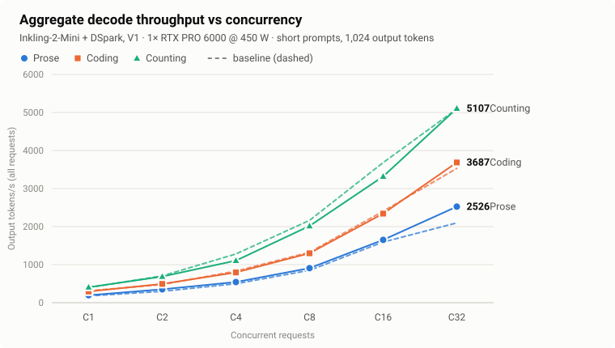
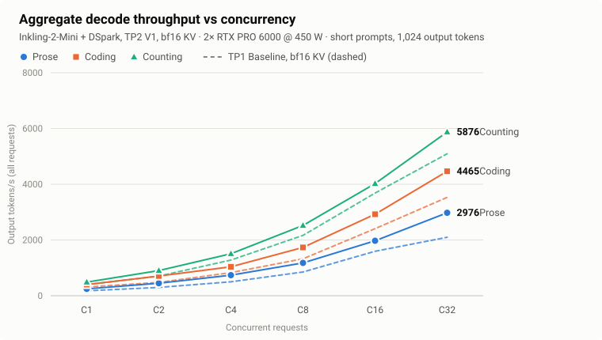
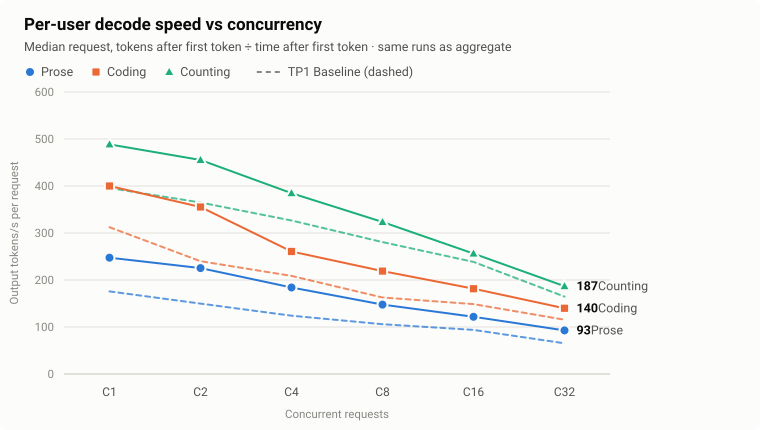
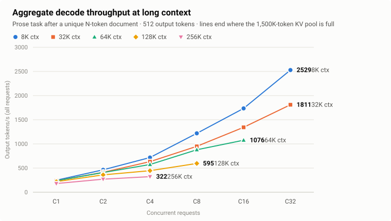

# Inkling-2-Mini on RTX PRO 6000 Blackwell (vLLM)

A tested recipe for serving [thinkingmachines/Inkling-2-Mini](https://huggingface.co/thinkingmachines/Inkling-2-Mini) with vLLM on one or two NVIDIA RTX PRO 6000 Blackwell Workstation Edition GPUs (SM120, 96 GB each), with the DSpark speculator that ships in the checkpoint.

Every result names its configuration: **TP1** is one GPU, **TP2** is two GPUs with tensor parallelism; **Baseline** is the official vLLM recipe plus the fixes SM120 needs to start, **V1** is the optimized patch in this repo. Same weights throughout. Every speed in this README was measured with the default **bf16 KV cache** unless the row or column says FP8 KV; nothing else is quantized.

## TL;DR

| | TP1 Baseline (bf16 KV) | TP1 V1 (bf16 KV) | TP2 V1 (bf16 KV) |
|---|---|---|---|
| Decode step, 1 user | 11.5 ms | 10.0 ms | **7.9 ms** |
| Decode step, 8 users | 19.6 ms | 17.2 ms | **13.1 ms** |
| Decode step, 32 users | 29.5 ms | 25.0 ms | **21.4 ms** |
| 1 user, prose / coding / counting (tok/s) | 176 / 312 / 396 | 196 / 295 / 407 | **248 / 400 / 488** |
| 8 users, combined (tok/s) | 852 / 1,326 / 2,165 | 909 / 1,300 / 2,016 | **1,177 / 1,734 / 2,523** |
| 32 users, combined (tok/s) | 2,097 / 3,530 / 5,094 | 2,526 / 3,687 / 5,107 | **2,976 / 4,465 / 5,876** |
| Prefill, 4K–16K prompt (tok/s) | ~19,000–19,800 | ~20,100–21,800 | **~25,000** |
| Prefill, 500K prompt (tok/s) | 5,218 | 5,403 | **8,418** |
| Draft tokens per step (K) | 7 | 4 | 4 |
| Largest max context that starts (bf16 KV, with the warm-up fix) | 1M | 1M | 1M |
| Reported KV pool at 1M, 0.95, 64 requests: bf16 / FP8 | — | 1.28M / 1.97M | 2.31M / 3.24M |
| KV cost per token, bf16 / FP8 (measured) | 36 KiB / — | 36 KiB / 20 KiB | 36 KiB / 20 KiB |

## Setup

- 1–2× RTX PRO 6000 Blackwell Workstation Edition (96 GB, 450 W), driver 595.99.02
- Image `vllm/vllm-openai:inkling-2-mini` (`sha256:c2dc759f…`): vLLM 0.1.dev25855, PyTorch 2.14 + CUDA 13.0, FlashInfer 0.7.4, Triton 3.8.0, NCCL 2.31.2, Python 3.14
- Checkpoint `thinkingmachines/Inkling-2-Mini` @ `1fb4134b9a74f9681054f4ef82e4bf1f458a2337` (mixed NVFP4 / MXFP8, ~20 GB). The DSpark drafter is built in: `mtp.safetensors` (0.6 GB) in the same checkpoint, sharing the model's embeddings and LM head.

## Quick start

```bash
hf download thinkingmachines/Inkling-2-Mini --revision 1fb4134b9a74f9681054f4ef82e4bf1f458a2337
./recipe/run.sh            # TP1 V1 on GPU 0 (GPU=1 for the other card)
TP=2 ./recipe/run.sh       # TP2 V1 on both cards
curl localhost:8000/v1/chat/completions -H 'Content-Type: application/json' \
  -d '{"model":"inkling-2-mini","messages":[{"role":"user","content":"Hello"}]}'
```

Extra vLLM flags are passed through, for example `./recipe/run.sh --max-model-len 400000`. Startup takes about 4 minutes. Reasoning is returned in `reasoning_content`; `reasoning_effort` (`none` … `max`) controls how much the model thinks. The first request at a new batch shape can stall for ~2.5 s while a kernel compiles.

### Flags and why

| Flag | TP1 V1 | TP2 V1 | Why |
|---|---|---|---|
| `--speculative-config` | `dspark`, 4 tokens, probabilistic | same | Recipe uses 7; see "Draft length". Needs the patched `dspark.py` |
| `--reasoning-parser` | `inkling` | same | From the official recipe |
| `--max-model-len` | 524288 | 1048576 | Per-session limit. Set it to what a session needs; the rest of the KV cache serves concurrent sessions |
| `--gpu-memory-utilization` | 0.95 | 0.95 | Safe with the warm-up fix below; without it, 0.90+ runs out of memory during warm-up |
| `--max-num-seqs` | 64 | 64 | The default of 1024 preallocates block tables that take 4–29+ GiB from the KV cache (see "The request limit") |
| `--disable-custom-all-reduce` | — | set | The custom all-reduce is in the SM100-only `_C` extension; NCCL is used instead |
| `--revision` | pinned | pinned | The HF cache has no `refs/main` for an offline start without it |

## Why the step takes as long as it does

The decode step on one card is limited by memory bandwidth, not by kernel quality:

- Every step reads the weights it uses from GPU memory: per layer pass, 54 MB of dense projections plus ~4.5 MB for each distinct expert the batch routes to; and there are 48 layer passes, because the middle 12 layers run three times. Add two 926 MB LM-head reads (model and drafter). That is 11–12 GB per step for one user and 25–30 GB at 8+ users, where nearly every expert is touched.
- The big kernels already read at 1.3–1.6 TB/s when the data is cold, against ~1.8 TB/s for the card. In isolation the expert GEMM reaches 4–5 TB/s on cached data and 1.55 TB/s cold, and 184 tile/warp/stage settings land within 1% of each other.
- At one user, ~9 ms of the 11.5 ms step is bandwidth-bound. The rest is ~850 small kernels, most of them already fused and chained with programmatic dependent launch by the model's authors.

So V1 goes after the two things left: the number of tokens verified per step, and a handful of small operations that were going through cuBLAS at many times their cost.

## What V1 changes

| # | Change | Effect | Exactness |
|---|---|---|---|
| 1 | Draft 4 tokens instead of 7 (the drafter runs a block of 5) | Step −7% at 1 user, −10 to −14% at 8–32 | Exact: verification is unchanged, only the draft differs |
| 2 | Loop controller's 4608→64 projection: all three streams with the reference K-group kernel in two launches, instead of a cuBLAS batched matmul | 24 µs → ~6 µs, 24× per step | Bit-identical to the reference `linear_k_groups`; 99.7–99.9% of bf16 values identical to cuBLAS, same error vs fp64 |
| 3 | Draft Markov head for a single request: tensor-core GEMV instead of cuBLAS gemv | 67 µs → 22 µs on the draft steps after the first | Draft only (≤1 bf16 ulp); cannot change outputs |
| 4 | Dynamic conv-tap projections on full-attention layers: Triton GEMV instead of cuBLAS | 12.6 µs → ~4 µs, 16× per step | Bit-identical |
| 5 | Logit soft-cap in one in-place pass instead of three | 841 µs → 280 µs on 256 rows | Bit-identical |

Changes 2–5 alone (still K=7) take the single-user step from 11.46 to 10.63 ms; they do little at 8+ users, where the step is almost entirely weight reads.

### Draft length

Stock vLLM only accepts K=7 for this checkpoint. With the patch the drafter runs a shorter block. Measured with `bench/step_matrix.py` (mean of prose, coding, counting; baseline kernels):

| K (TP1, bf16 KV) | Step, 1 user | Step, 8 users | Step, 32 users | Tok/s at 1 / 8 / 32 users |
|---|---|---|---|---|
| 7 | 11.5 ms | 19.6 ms | 29.5 ms | 273 / 1,469 / 3,780 |
| 5 | 11.2 ms | 18.5 ms | 27.0 ms | 277 / 1,393 / 3,802 |
| 4 | 10.7 ms | 17.6 ms | 25.4 ms | 271 / 1,393 / 3,749 |
| 3 | 10.2 ms | 16.8 ms | 23.1 ms | 258 / 1,289 / 3,737 |

Acceptance by draft position at K=7 is 67 / 45 / 31 / 23 / 18 / 14 / 11%, so the last three positions add 0.4 tokens per step while every step pays to verify them. K trades tokens per step for step time almost one for one; K=4 keeps throughput within a few percent and shortens each step. Pass a different `num_speculative_tokens` (1–7) to move along that line.

### Tried and dropped

- Tuning the expert GEMM tiles: no effect cold (bandwidth-bound).
- Prefetching the next dense weights into L2 while small kernels run: the prefetches are dropped; no gain.
- One kernel for the whole loop controller (normalize, both projections, blend): correct but slower, since one thread block per row cannot pull 1.2 MB of weights fast enough.
- Lossy options (FP8 KV cache, pruned draft vocabulary) are out of scope here.

## TP2

Two cards double the memory bandwidth that bounds the step, and each holds half of every weight. On SM120 it needs two fixes beyond TP1 (both in `patch/`): the sharded token embedding uses a fused kernel from the SM100-only `_C` extension, so it is switched to the plain mask-embed-zero path (same result), and `--disable-custom-all-reduce` moves all-reduce to NCCL. Without them TP2 dies at startup with `no kernel image is available`, reported at an unrelated line in the drafter.

| | TP1 V1 | TP2 V1 |
|---|---|---|
| Decode step at 1 / 8 / 32 users | 10.0 / 17.2 / 25.0 ms | 7.9 / 13.1 / 21.4 ms |
| Mean tok/s at 1 / 8 / 32 users | 301 / 1,424 / 3,807 | 374 / 1,821 / 4,446 |
| 998K-token prompt | not run | 201 s to first token, 4,964 tok/s |

The gain is 15–24% per step rather than 2× because every layer now pays an NCCL all-reduce (the fast custom one is not available on this hardware in this image) and the drafter, LM head and sampling do not split evenly.

## KV cache: size, the warm-up fix, and FP8

### What a token costs

Measured by sending one request at a time and reading `vllm:kv_cache_usage_perc` once prefill has finished: **36.0 KiB per token** with the bf16 cache, **20.0 KiB** with FP8. That matches the model: the middle 12 of its 24 layers run three times with a KV cache per pass, so there are 8 full-attention caches (layers 5 and 23 once, 11 and 17 three times) at 8 KV heads × 128 × 2 bytes × (K and V) = 4 KiB each, 32 KiB, plus one 4 KiB cache in the drafter. Sliding-window layers keep only 1,024 tokens.

vLLM's "GPU KV cache size" is not capacity. It is (max-length requests that fit, by vLLM's per-request estimate) × `--max-model-len`, and that estimate includes a prefill transient: any prompt longer than one 8K chunk briefly takes ~16 GiB more (a 330K prompt peaked at 63% of the pool, then sat at 26%), apparently because window and conv-state groups hold blocks for the chunks in flight. So a 1M request is 36 GiB at rest but vLLM asks for 52.6 GiB.

### The warm-up fix

Symptoms before the fix: bf16 ran out of memory in warm-up at `--gpu-memory-utilization` 0.90 and above, so 1M context (which needs more cache than 0.85 gives) was out of reach on one card; and FP8 KV crashed in warm-up at any utilization once `--max-model-len` was 512K or more, although its cache is smaller.

Cause (`vllm/v1/worker/extensible_kv_cache.py`): the KV cache is committed lazily. During warm-up vLLM may commit blocks for dummy requests up to "free memory minus a reserve", and the reserve is 10% of free memory plus a margin, about 13 GiB here. The warm-up steps need 9–12 GiB of activations plus allocator growth. With the bf16 layout (13 cache groups) warm-up asks for few blocks, so it only fails when utilization is high; with FP8 (99 groups, one per layer per pass) the same dummy requests ask for far more blocks and the commit runs to the limit: the debug log shows 197,731 of 227,708 blocks, 48.3 GiB, committed just before the sampler's 3.8 GiB logits buffer fails to allocate.

Fix: `KV_CACHE_WARMUP_RESERVE_FRACTION` 0.1 → 0.25. It only bounds what warm-up may commit (6.9 GiB after the fix); the final cache is still sized from the memory measured after warm-up.

Startup at `--gpu-memory-utilization 0.95 --max-model-len 1048576` with the fix (startup lines for each in `docs/logs/`):

| Run | Result |
|---|---|
| TP1 Baseline settings (bf16, K=7) | Starts. 53.4 GiB KV, pool 1,064,375 (1.02 × 1M) |
| TP1 V1 (bf16, K=4) | Starts. 52.8 GiB KV, pool 1,051,070 (1.00 × 1M) |
| TP2 V1 (bf16, K=4) | Starts. 51.8 GiB KV per GPU, pool 1,640,770 (1.56 × 1M) |
| TP1 V1 + FP8 KV | Does not start: 32.6 GiB available, 33.4 GiB needed. No crash; vLLM estimates a max context of 1,009,344 |
| TP1 Baseline settings + FP8 KV (K=7) | Does not start: 33.0 GiB available, 33.4 GiB needed (max 1,025,408) |
| TP2 V1 + FP8 KV | Does not start: 18.3 GiB available per GPU, 22.7 GiB needed (max 584,576) |

### FP8 KV compared

Same card, same patch, K=4, `--gpu-memory-utilization 0.85 --max-model-len 524288`, with the fix:

| | TP1 V1 (bf16 KV) | TP1 V1 + FP8 KV |
|---|---|---|
| KV memory allocated | 47.13 GiB | 35.69 GiB |
| Measured cost per token | 36.0 KiB | 20.0 KiB |
| Real capacity (memory ÷ cost) | 1.37M tokens | 1.87M tokens |
| Pool vLLM reports | 713,193 (1.36 × 512K) | 800,147 (1.53 × 512K) |

| | TP1 V1 | TP1 V1 + FP8 KV | TP2 V1 | TP2 V1 + FP8 KV |
|---|---|---|---|---|
| Decode step at 1 / 8 / 32 users | 10.0 / 17.2 / 25.0 ms | 10.0 / 17.0 / 24.6 ms | 7.9 / 13.1 / 21.4 ms | 7.9 / 13.1 / 21.2 ms |
| Recall, 10 lookups × 3 documents at 29K / 119K / 239K tokens | 30 / 30 / 30 of 30 | 30 / 30 / 30 of 30 | 30 / 30 / 30 of 30 | 30 / 30 / 30 of 30 |

(The FP8 step and recall runs used `--max-model-len 262144`, before the fix.)

- FP8 costs 44% less per token and holds 36% more tokens at these settings, with no change in step time and no loss in the recall check (`bench/recall.py`). The recall check is a retrieval test, not a full quality evaluation.
- It does not hold 80% more because FP8 mode is given less memory: about 12 GiB less is free after warm-up at a 512K max context, 23 GiB less at 1M on one card, and 44 GiB less per GPU at 1M on TP2. That overhead grows with `--max-model-len`; its source is not yet identified (`--max-num-seqs 64` does not change it). It is why FP8 cannot reach 1M here while bf16 can.
- So in this build FP8 KV buys more concurrent sessions at moderate per-session limits, not longer sessions. Prefill was not measured carefully with FP8 (two sweeps, affected by one-off compiles); at 128K–262K it was within about ±12% of bf16.
- Keys in FP8 with values in bf16 is not available: K and V share one tensor and one dtype in this model's cache.

### Serving for many sessions

If sessions never exceed about 400K tokens, set `--max-model-len 400000 --gpu-memory-utilization 0.95`: TP1 V1 comes up with 54.9 GiB of KV cache, a reported pool of 723,095 tokens (1.81 × 400K by vLLM's estimate) and about 1.6M tokens of real capacity.

## TP2 V1

Two cards double the memory bandwidth that bounds the step, and TP2 fits the full 1M context with room for more sessions. Measured with the V1 patch, K=4, bf16 KV, 1M max context (`bench/results/tp2-v1/`):

| | TP1 V1 (bf16 KV) | TP2 V1 (bf16 KV) | Change |
|---|---|---|---|
| Decode step, 1 / 8 / 32 users | 10.0 / 17.2 / 25.0 ms | 7.9 / 13.1 / 21.4 ms | −21% / −24% / −15% |
| Mean tok/s at 1 / 8 / 32 users | 301 / 1,424 / 3,807 | 374 / 1,821 / 4,446 | +24% / +28% / +17% |
| Prefill, 16K / 128K / 500K (tok/s) | 20,055 / 12,288 / 5,403 | 24,960 / 14,795 / 8,418 | +24% / +20% / +56% |
| One 998K-token prompt | not run | 201 s to first token (4,964 tok/s) | |

The gain is well short of 2× because every layer now pays two all-reduces over PCIe through NCCL: vLLM's faster custom all-reduce lives in the `_C` extension, which this image builds for SM100 only. Per GPU, TP1 is still the more efficient way to serve (two TP1 servers out-produce one TP2 server at high concurrency); TP2 buys lower latency per request and the 1M context.

TP2 needs two fixes on SM120 beyond TP1: the fused sharded token embedding (`ops.vocab_parallel_embedding`, in `_C`) is switched to the unfused PyTorch path, and `--disable-custom-all-reduce`. Both failures show up as `CUDA error: no kernel image is available` at an unrelated line in the drafter.

## KV cache

### What a token costs

Measured by sending one request at a time and reading `vllm:kv_cache_usage_perc` once prefill has finished:

| KV dtype | Measured per token | Where it comes from |
|---|---|---|
| bf16 (default) | 36.0 KiB | 8 full-attention caches in the model (layers 5 and 23 once, 11 and 17 once per loop pass) × 8 KV heads × 128 × K and V × 2 bytes = 32 KiB, plus 4 KiB for the drafter's one full-attention layer |
| FP8 (`--kv-cache-dtype fp8`) | 20.0 KiB | The same at 1 byte per value, plus per-group rounding |

Sliding-window and conv-state layers keep about 1,024 tokens per request, so they are a small fixed cost (about 0.3 GiB per active request in bf16).

vLLM's reported "GPU KV cache size" is not memory ÷ cost. It is (max-length requests that fit, by a per-request estimate) × `--max-model-len`, and the estimate includes a prefill spike: a prompt longer than one 8K prefill chunk temporarily holds ~38% of a 44 GiB pool as soon as prefill starts (a 330K prompt peaked at 63% and settled at 26%). So the reported pool understates how many tokens of finished context fit, by about 1.5–2×.

### The warm-up fix

Stock, three things failed at startup with out-of-memory errors in the sampler's warm-up step, although the final cache would have fit:

- bf16 KV at `--gpu-memory-utilization` 0.90 or more (TP1);
- bf16 KV with a 1M max context on one card;
- FP8 KV with a 512K or larger max context, at any utilization that left enough cache (TP1 and TP2).

Cause: in this build the KV cache is "extensible" and is given its final size only after warm-up, but warm-up itself commits KV blocks for its dummy requests, up to free memory minus a reserve of 10% (plus a margin, ~13 GiB here). The warm-up steps then need 9–12 GiB of activations plus allocator growth. With bf16's 13 cache groups the commit usually stays small; with FP8's 99 groups (one per layer and loop pass) it reaches the limit. A debug log of FP8 at 512K shows `Committed 197731 of 227708 KV cache blocks (48.28 GiB physical)` seconds before the 3.8 GiB logits buffer fails to allocate.

Fix (`patch/vllm/v1/worker/extensible_kv_cache.py`): `KV_CACHE_WARMUP_RESERVE_FRACTION` 0.10 → 0.25. It only bounds what warm-up may commit (6.9 GiB in the same FP8 start afterwards); the final cache is still sized from the memory measured after warm-up.

### The request limit

On a card this size vLLM defaults to `--max-num-seqs 1024`, and for every request slot it preallocates two GPU block tables per cache group, each as long as the max context needs. bf16 KV uses 13 cache groups, so at a 1M max context that is about 4 GiB. FP8 KV uses 99 groups (one per layer and loop pass), so it is about 29 GiB on TP1 and more per card on TP2, taken straight out of the KV cache. That is why FP8 mode appeared to have less cache than bf16, and why TP2 FP8 could not start at 1M.

Setting a realistic limit removes it and also shrinks warm-up (its buffers scale with the limit). The recipe uses `--max-num-seqs 64`.

Start-up results with the warm-up fix, `--gpu-memory-utilization 0.95`, `--max-model-len 1048576`, V1 patch (K=4). No benchmark; the lines vLLM printed are in `docs/logs/`:

| Config | Default limit (1024) | `--max-num-seqs 64` |
|---|---|---|
| TP1 V1, bf16 KV | Starts: 52.8 GiB KV, pool 1,051,070 (1.00 × 1M) | Starts: 64.1 GiB KV, pool 1,276,200 (1.22 × 1M) |
| TP1 V1, FP8 KV | Does not start: 32.6 GiB available, 33.4 needed | Starts: 62.6 GiB KV, pool 1,966,068 (1.87 × 1M) |
| TP2 V1, bf16 KV | Starts: 51.75 GiB per card, pool 1,640,770 (1.56 × 1M) | Starts: 72.9 GiB per card, pool 2,311,235 (2.20 × 1M) |
| TP2 V1, FP8 KV | Does not start: 18.3 GiB per card available, 22.7 needed | Starts: 70.1 GiB per card, pool 3,239,785 (3.09 × 1M) |

TP1 bf16 with the recipe's K=7 also starts at the default limit (53.4 GiB, pool 1,064,375), and TP1 FP8 with K=7 misses by 0.44 GiB. With a limit of 16, TP1 FP8 gets 65.0 GiB (pool 2,040,351).

At the measured per-token costs, the `--max-num-seqs 64` caches hold about 1.87M tokens (TP1 bf16) and 3.28M tokens (TP1 FP8) of finished context.

For serving, set `--max-model-len` to the longest session you need and leave the rest to concurrency: TP1 V1 with bf16 KV, a 400,000-token limit, 0.95 and 64 requests comes up with 64.5 GiB of KV cache (reported pool 849,707, 2.12 × 400K) and the same step times as the benchmark (9.95 / 17.1 / 25.3 ms at 1 / 8 / 32 users). TP2 V1 with the same settings comes up with 73.5 GiB per card (reported pool 1,339,356, 3.35 × 400K) and 7.8 / 13.2 / 23.8 ms per step; the 32-user figure is slower than the 21.4 ms of the full benchmark, from one quick run.

Note for SparkDeck: an extra `--max-num-seqs` argument is dropped; set the deployment's max concurrency instead.

### FP8 KV against bf16 KV

Like for like on TP1 V1 (K=4, warm-up fix applied, default request limit, `--gpu-memory-utilization 0.85`, 512K max context):

| | TP1 V1, bf16 KV | TP1 V1, FP8 KV |
|---|---|---|
| KV memory allocated | 47.13 GiB | 35.69 GiB |
| Measured cost per token | 36.0 KiB | 20.0 KiB |
| Tokens that fit (memory ÷ cost) | ~1.37M | ~1.87M |
| Reported pool | 713,193 (1.36 × 512K) | 800,147 (1.53 × 512K) |

Speed and recall (FP8 runs at a 262K max context, before the fix was found; bf16 runs are the full V1 benchmarks):

| | TP1 V1, bf16 | TP1 V1, FP8 KV | TP2 V1, bf16 | TP2 V1, FP8 KV |
|---|---|---|---|---|
| Decode step, 1 / 8 / 32 users (ms) | 10.0 / 17.2 / 25.0 | 10.0 / 17.0 / 24.6 | 7.9 / 13.1 / 21.4 | 7.9 / 13.1 / 21.2 |
| Mean tok/s at 1 / 8 / 32 users | 301 / 1,424 / 3,807 | 298 / 1,447 / 3,920 | 374 / 1,821 / 4,446 | 385 / 1,820 / 4,517 |
| Prefill, 128K / 256K (tok/s) | 12,288 / 8,281 | 10,754 / 7,507 | 14,795 / 12,595 | 15,676 / 11,875 |
| Recall at 29K / 119K / 239K tokens | 30/30 each | 30/30 each | 30/30 each | 30/30 each |

FP8 KV costs 44% less per token, decodes at the same speed, and passed the recall check (`bench/recall.py`: 10 exact lookups in a numbered log, 3 trials per size, temperature 0). Long-prompt prefill was 9–12% slower on TP1 and within ±6% on TP2 (two sweeps each; shorter sizes hit one-off kernel compiles on the fresh servers and are left out). It is lossy, and this check is narrow; it is not a quality evaluation. At the default request limit FP8 gets about 11 GiB less cache than bf16 here (see "The request limit"); with `--max-num-seqs 64` the two get nearly the same memory and FP8 holds about 1.75× the tokens. Mixed precision (FP8 keys, bf16 values) is not supported: K and V share one cache tensor.

## The patch

Nine files in `patch/vllm` are bind-mounted over the image (diffs against the image in `patch/diffs/`):

| File | Needed for | What it does |
|---|---|---|
| `v1/attention/backends/fa_utils.py` | Starting on SM120 | KV-cache write via vLLM's Triton kernel; the `_C` one is SM100-only. Identical bytes |
| `model_executor/layers/vocab_parallel_embedding.py` | TP2 on SM120 | Unfused sharded embedding instead of the `_C` op. Same result |
| `v1/worker/extensible_kv_cache.py` | 0.90+ utilization, 1M context, FP8 KV | Warm-up reserve fix (above) |
| `models/inkling2/nvidia/dspark.py` | V1 | Allows K<7 (short draft block); single-request Markov GEMV |
| `models/inkling2/nvidia/loop.py`, `ops/loop_fused.py` | V1 | Stream-batched loop controller projection |
| `models/inkling2/nvidia/sconv.py` | V1 | Dynamic-tap GEMV |
| `models/inkling2/nvidia/model.py`, `ops/softcap.py` | V1 | One-pass soft-cap |

The `_C` failures all look the same: `CUDA error: no kernel image is available for execution on the device`, raised later at an unrelated line (even with `CUDA_LAUNCH_BLOCKING=1`), because the failed launch is not checked. `tests/` compares each new path with the one it replaces (run inside the serving container).

## Benchmarks

Method (`bench/`, stdlib Python against the OpenAI endpoint): prefill is one request at a time with unique random text so the prefix cache never hits, `max_tokens` 1, median of 5 warm sweeps. Decode is C concurrent requests, temperature 0, 1,024 output tokens (reasoning included); throughput is measured over the window in which all C requests are decoding. Long-context decode puts a unique N-token document before a short-story task, with 512 output tokens; cells that need more KV than the reported pool are skipped ("—"). Step times come from `bench/step_matrix.py` (`bench/results/steps/`). Tables: `python3 bench/make_tables.py baseline v1 tp2-v1`.

Run settings: TP1 Baseline is K=7, 0.85 utilization, 512K max context, on GPU 0. TP1 V1 is K=4, 0.75, 512K, on GPU 1. TP2 V1 is K=4, 0.85, 1M. These predate the warm-up fix; utilization changes the pool, not the speed. In the V1 runs, prefill sizes up to 64K were re-measured after the first pass, which hit one-off kernel compiles (first pass kept as `results-prefill-firstpass*.json`).

**TP1 V1, bf16 KV** (dashed: TP1 Baseline, bf16 KV)

<picture><source media="(prefers-color-scheme: dark)" srcset="docs/charts/decode-aggregate-dark.svg"></picture>

<picture><source media="(prefers-color-scheme: dark)" srcset="docs/charts/decode-per-user-dark.svg"></picture>

<picture><source media="(prefers-color-scheme: dark)" srcset="docs/charts/decode-context-dark.svg"></picture>

**TP2 V1, bf16 KV** (dashed: TP1 Baseline, bf16 KV)

<picture><source media="(prefers-color-scheme: dark)" srcset="docs/charts/tp2/decode-aggregate-dark.svg"></picture>

<picture><source media="(prefers-color-scheme: dark)" srcset="docs/charts/tp2/decode-per-user-dark.svg"></picture>

<picture><source media="(prefers-color-scheme: dark)" srcset="docs/charts/tp2/decode-context-dark.svg"></picture>

In the tables below, "Change" compares the last column with TP1 Baseline, and the per-user and TTFT columns are TP2 V1's.

### Prefill

| Prompt tokens | TP1 Baseline (bf16 KV) tok/s | TP1 V1 (bf16 KV) tok/s | TP2 V1 (bf16 KV) tok/s | Change | Time to first token (s) |
| --- | --- | --- | --- | --- | --- |
| 1,030 | 15,311 | 19,511 | **20,394** | +33% | 0.05 |
| 4,103 | 19,675 | 21,812 | **25,044** | +27% | 0.16 |
| 8,195 | 19,844 | 20,419 | **25,096** | +26% | 0.33 |
| 16,332 | 19,045 | 20,055 | **24,960** | +31% | 0.66 |
| 32,743 | 17,555 | 18,540 | **23,682** | +35% | 1.38 |
| 65,307 | 15,203 | 16,021 | **21,274** | +40% | 3.08 |
| 130,993 | 11,826 | 12,288 | **14,795** | +25% | 8.85 |
| 261,732 | 8,037 | 8,281 | **12,595** | +57% | 20.78 |
| 499,466 | 5,218 | 5,403 | **8,418** | +61% | 59.27 |

### Decode

| Workload | C | TP1 Baseline (bf16 KV) tok/s | TP1 V1 (bf16 KV) tok/s | TP2 V1 (bf16 KV) tok/s | Change | Per-user tok/s | TTFT p50 (s) |
| --- | --- | --- | --- | --- | --- | --- | --- |
| Prose (short story) | 1 | 175.7 | 196.1 | **247.5** | +41% | 247.5 | 0.03 |
|  | 2 | 298.9 | 350.8 | **449.1** | +50% | 225.2 | 0.03 |
|  | 4 | 498.1 | 541.9 | **739.0** | +48% | 184.1 | 0.04 |
|  | 8 | 851.9 | 909.3 | **1176.5** | +38% | 147.6 | 0.06 |
|  | 16 | 1593.0 | 1650.6 | **1972.6** | +24% | 121.8 | 1.05 |
|  | 32 | 2097.4 | 2526.4 | **2975.6** | +42% | 92.8 | 2.02 |
| Coding (Python + tests) | 1 | 312.3 | 294.6 | **399.9** | +28% | 399.9 | 0.03 |
|  | 2 | 475.9 | 494.3 | **707.1** | +49% | 355.3 | 0.03 |
|  | 4 | 829.0 | 795.6 | **1038.6** | +25% | 260.6 | 0.05 |
|  | 8 | 1325.7 | 1300.0 | **1733.7** | +31% | 219.0 | 0.06 |
|  | 16 | 2404.4 | 2341.6 | **2925.9** | +22% | 181.5 | 0.26 |
|  | 32 | 3530.1 | 3686.7 | **4464.6** | +26% | 139.8 | 0.99 |
| Counting (1…400 in words) | 1 | 395.8 | 407.1 | **488.4** | +23% | 488.4 | 0.03 |
|  | 2 | 704.6 | 687.8 | **902.1** | +28% | 455.4 | 0.04 |
|  | 4 | 1279.9 | 1106.2 | **1506.7** | +18% | 384.6 | 0.05 |
|  | 8 | 2164.6 | 2016.2 | **2522.5** | +17% | 323.5 | 0.06 |
|  | 16 | 3682.5 | 3320.2 | **4023.4** | +9% | 256.1 | 1.85 |
|  | 32 | 5093.6 | 5106.7 | **5876.2** | +15% | 186.8 | 3.05 |

DSpark during the decode matrix: TP1 Baseline 29.8% of draft tokens accepted, 3.09 tokens per step (K=7); TP1 V1 43.3%, 2.73 (K=4); TP2 V1 43.6%, 2.74 (K=4).

### Long-context decode

| Context | C | TP1 Baseline (bf16 KV) tok/s | TP1 V1 (bf16 KV) tok/s | TP2 V1 (bf16 KV) tok/s | Change | Per-user tok/s | TTFT p50 (s) |
| --- | --- | --- | --- | --- | --- | --- | --- |
| 8K | 1 | 178.2 | 191.1 | **249.4** | +40% | 249.4 | 0.3 |
| 8K | 2 | 307.8 | 324.0 | **463.7** | +51% | 193.3 | 1.2 |
| 8K | 4 | 482.1 | 518.3 | **718.6** | +49% | 176.8 | 1.3 |
| 8K | 8 | 866.8 | 870.3 | **1219.2** | +41% | 130.6 | 2.0 |
| 8K | 16 | 1189.9 | 1404.6 | **1734.7** | +46% | 59.8 | 3.3 |
| 8K | 32 | 1607.3 | 1925.6 | **2528.8** | +57% | 42.0 | 5.8 |
| 16K | 1 | 183.7 | 174.3 | **249.3** | +36% | 249.3 | 0.7 |
| 16K | 2 | 289.7 | 353.7 | **451.5** | +56% | 226.1 | 1.3 |
| 16K | 4 | 449.9 | 508.4 | **743.7** | +65% | 160.4 | 2.3 |
| 16K | 8 | 712.5 | 784.6 | **1070.4** | +50% | 99.5 | 3.5 |
| 16K | 16 | 1066.8 | 1139.1 | **1559.7** | +46% | 45.1 | 6.2 |
| 16K | 32 | 1436.0 | — | **2159.5** | +50% | 27.9 | 11.4 |
| 32K | 1 | 162.6 | 178.2 | **238.6** | +47% | 238.6 | 1.4 |
| 32K | 2 | 264.0 | 324.9 | **412.2** | +56% | 176.2 | 2.2 |
| 32K | 4 | 424.9 | 447.8 | **633.1** | +49% | 114.8 | 4.1 |
| 32K | 8 | 616.2 | 660.7 | **949.9** | +54% | 61.9 | 6.8 |
| 32K | 16 | 941.8 | — | **1343.8** | +43% | 30.0 | 12.4 |
| 32K | 32 | — | — | **1810.8** | — | 15.8 | 23.8 |
| 64K | 1 | 163.4 | 162.0 | **236.9** | +45% | 236.9 | 3.1 |
| 64K | 2 | 262.2 | 268.2 | **407.0** | +55% | 152.6 | 4.9 |
| 64K | 4 | 350.7 | 386.4 | **573.9** | +64% | 68.7 | 8.1 |
| 64K | 8 | 500.8 | — | **879.2** | +76% | 34.5 | 14.8 |
| 64K | 16 | — | — | **1076.2** | — | 16.3 | 27.6 |
| 128K | 1 | 146.1 | 144.2 | **219.0** | +50% | 219.0 | 7.5 |
| 128K | 2 | 211.1 | 240.9 | **359.7** | +70% | 120.1 | 11.7 |
| 128K | 4 | 278.4 | 330.1 | **445.7** | +60% | 35.0 | 19.9 |
| 128K | 8 | — | — | **595.3** | — | 14.9 | 36.0 |
| 256K | 1 | 114.8 | 120.2 | **180.2** | +57% | 180.2 | 22.7 |
| 256K | 2 | 147.8 | 172.5 | **269.9** | +83% | 81.0 | 31.7 |
| 256K | 4 | — | — | **322.1** | — | 14.1 | 53.6 |

### Power

All bf16 KV.

| Phase | Avg / max power per GPU | Peak temp |
| --- | --- | --- |
| Prefill sweeps (5×, warm) | 423 / 461 W, 401 / 471 W | 73 / 83 °C |
| Decode, C1–C32 | 358 / 423 W, 373 / 436 W | 63 / 77 °C |
| Long-context decode | 429 / 459 W, 407 / 458 W | 73 / 82 °C |

TP1 Baseline averaged 443 / 422 / 427 W and TP1 V1 434 / 413 / 437 W on one card in the same three phases.

## Next

- A faster all-reduce for TP2 on SM120 (the custom one needs an SM120 build of `_C`).
- The prefill KV spike: sliding-window and conv-state groups pay full-size blocks for in-flight chunks.
