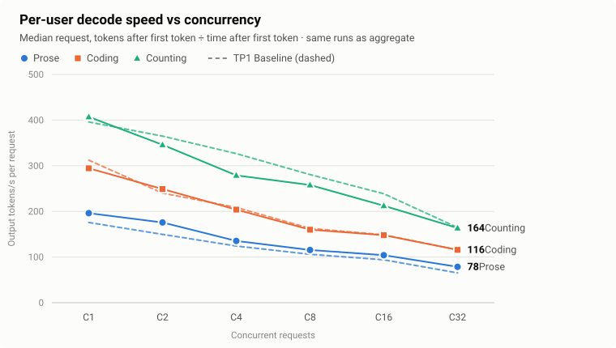

# Inkling-2-Mini on RTX PRO 6000 Blackwell (vLLM)

A tested recipe for serving [thinkingmachines/Inkling-2-Mini](https://huggingface.co/thinkingmachines/Inkling-2-Mini) with vLLM on NVIDIA RTX PRO 6000 Blackwell Workstation Edition GPUs (SM120, 96 GB), with the DSpark speculator that ships in the checkpoint.

**Status: V1, 1 GPU (TP1).** Baseline is the official vLLM recipe plus the one fix SM120 needs to start. V1 cuts the decode step by 12–15% with the same weights and no quantization. TP2 (2 GPUs) is next.

## TL;DR

| | Baseline | V1 |
|---|---|---|
| Decode step, 1 user | 11.5 ms | **10.0 ms** |
| Decode step, 8 users | 19.6 ms | **17.2 ms** |
| Decode step, 32 users | 29.5 ms | **25.0 ms** |
| Single-user decode, prose / coding / counting (tok/s) | 176 / 312 / 396 | **196 / 295 / 407** |
| 8 users, combined (tok/s) | 852 / 1,326 / 2,165 | **909 / 1,300 / 2,016** |
| 32 users, combined (tok/s) | 2,097 / 3,530 / 5,094 | **2,526 / 3,687 / 5,107** |
| Prefill, 4K–16K prompt (tok/s) | ~19,000–19,800 | **~20,100–21,800** |
| Draft tokens per step (K) | 7 | **4** |
| DSpark acceptance | 30% of drafts, 3.1 tok/step | **43% of drafts, 2.7 tok/step** |
| Max context | 524,288 | 524,288 |
| KV pool reported (GPU memory utilization) | 671,695 (0.85) | 548,794 (0.75) |

V1 shortens every step; throughput is roughly unchanged overall (up for prose, down a little for highly predictable text) because each step now verifies 5 tokens instead of 8.

## Setup

- 1× RTX PRO 6000 Blackwell Workstation Edition (96 GB, 450 W), driver 595.99.02
- Image `vllm/vllm-openai:inkling-2-mini` (`sha256:c2dc759f…`): vLLM 0.1.dev25855, PyTorch 2.14 + CUDA 13.0, FlashInfer 0.7.4, Triton 3.8.0, Python 3.14
- Checkpoint `thinkingmachines/Inkling-2-Mini` @ `1fb4134b9a74f9681054f4ef82e4bf1f458a2337` (mixed NVFP4 / MXFP8, ~20 GB, plus the 0.6 GB DSpark drafter in `mtp.safetensors`)

## Quick start

```bash
hf download thinkingmachines/Inkling-2-Mini --revision 1fb4134b9a74f9681054f4ef82e4bf1f458a2337
./recipe/run.sh            # GPU=1 to use the second card; extra vllm flags are passed through
curl localhost:8000/v1/chat/completions -H 'Content-Type: application/json' \
  -d '{"model":"inkling-2-mini","messages":[{"role":"user","content":"Hello"}]}'
```

Startup takes about 4 minutes (most of it is CUDA graph capture). Reasoning is returned in `reasoning_content`; `reasoning_effort` (`none` … `max`) controls how much the model thinks. The first request at a new batch shape can stall for ~2.5 s while a kernel compiles.

### Flags and why

| Flag | Value | Why |
|---|---|---|
| `--speculative-config` | `dspark`, **4** tokens, probabilistic | Recipe uses 7; see "Draft length" below. Needs the patched `dspark.py` (stock vLLM only accepts 7) |
| `--reasoning-parser` | `inkling` | From the official recipe |
| `--max-model-len` | 524288 | The full 1M context is rejected at startup on one card (vLLM asks for 52.6 GiB of KV cache) |
| `--gpu-memory-utilization` | 0.75 | A ~550K-token pool. 0.85 is the most that starts (0.90+ runs out of memory in sampler warm-up); with K=4, one 512K request needs ≥0.75 |
| `--revision` | pinned | The HF cache has no `refs/main` for an offline start without it |

## Why the step takes as long as it does

The decode step on one card is limited by memory bandwidth, not by kernel quality:

- Every step reads the weights it uses from GPU memory: per layer pass, 54 MB of dense projections plus ~4.5 MB for each distinct expert the batch routes to; and there are 48 layer passes, because the middle 12 layers run three times. Add two 926 MB LM-head reads (model and drafter). That is 11–12 GB per step for one user and 25–30 GB at 8+ users, where nearly every expert is touched.
- The big kernels already read at 1.3–1.6 TB/s when the data is cold, against ~1.8 TB/s for the card. In isolation the expert GEMM reaches 4–5 TB/s on cached data and 1.55 TB/s cold, and 184 tile/warp/stage settings land within 1% of each other.
- At one user, ~9 ms of the 11.5 ms step is bandwidth-bound. The rest is ~850 small kernels, most of them already fused and chained with programmatic dependent launch by the model's authors.

So V1 goes after the two things left: the number of tokens verified per step, and a handful of small operations that were going through cuBLAS at many times their cost.

## What V1 changes

| # | Change | Effect | Exactness |
|---|---|---|---|
| 1 | Draft 4 tokens instead of 7 (the drafter runs a block of 5) | Step −7% at 1 user, −10 to −14% at 8–32 | Exact: verification is unchanged, only the draft differs |
| 2 | Loop controller's 4608→64 projection: all three streams with the reference K-group kernel in two launches, instead of a cuBLAS batched matmul | 24 µs → ~6 µs, 24× per step | Bit-identical to the reference `linear_k_groups`; 99.7–99.9% of bf16 values identical to cuBLAS, same error vs fp64 |
| 3 | Draft Markov head for a single request: tensor-core GEMV instead of cuBLAS gemv | 67 µs → 22 µs on the draft steps after the first | Draft only (≤1 bf16 ulp); cannot change outputs |
| 4 | Dynamic conv-tap projections on full-attention layers: Triton GEMV instead of cuBLAS | 12.6 µs → ~4 µs, 16× per step | Bit-identical |
| 5 | Logit soft-cap in one in-place pass instead of three | 841 µs → 280 µs on 256 rows | Bit-identical |

Changes 2–5 alone (still K=7) take the single-user step from 11.46 to 10.63 ms; they do little at 8+ users, where the step is almost entirely weight reads.

### Draft length

Stock vLLM only accepts K=7 for this checkpoint. With the patch the drafter runs a shorter block. Measured with `bench/step_matrix.py` (mean of prose, coding, counting; baseline kernels):

| K | Step, 1 user | Step, 8 users | Step, 32 users | Tok/s at 1 / 8 / 32 users |
|---|---|---|---|---|
| 7 | 11.5 ms | 19.6 ms | 29.5 ms | 273 / 1,469 / 3,780 |
| 5 | 11.2 ms | 18.5 ms | 27.0 ms | 277 / 1,393 / 3,802 |
| 4 | 10.7 ms | 17.6 ms | 25.4 ms | 271 / 1,393 / 3,749 |
| 3 | 10.2 ms | 16.8 ms | 23.1 ms | 258 / 1,289 / 3,737 |

Acceptance by draft position at K=7 is 67 / 45 / 31 / 23 / 18 / 14 / 11%, so the last three positions add 0.4 tokens per step while every step pays to verify them. K trades tokens per step for step time almost one for one; K=4 keeps throughput within a few percent and shortens each step. Pass a different `num_speculative_tokens` (1–7) to move along that line.

### Tried and dropped

- Tuning the expert GEMM tiles: no effect cold (bandwidth-bound).
- Prefetching the next dense weights into L2 while small kernels run: the prefetches are dropped; no gain.
- One kernel for the whole loop controller (normalize, both projections, blend): correct but slower, since one thread block per row cannot pull 1.2 MB of weights fast enough.
- Lossy options (FP8 KV cache, pruned draft vocabulary) are out of scope here.

## The patch

Seven files in `patch/vllm` are bind-mounted over the image (diffs against the image in `patch/diffs/`):

1. `v1/attention/backends/fa_utils.py` — **required on SM120.** The image builds vLLM's `_C` extension for SM100 only, so the KV-cache write `reshape_and_cache_flash` fails with `no kernel image is available` (surfacing later at an unrelated op in the drafter, even with `CUDA_LAUNCH_BLOCKING=1`). This switches to vLLM's Triton writer, which writes identical bytes.
2. `models/inkling2/nvidia/dspark.py` — allows K<7 (short draft block) and the single-request Markov GEMV.
3. `models/inkling2/nvidia/loop.py` + `ops/loop_fused.py` — the stream-batched loop controller projection.
4. `models/inkling2/nvidia/sconv.py` — dynamic-tap GEMV.
5. `models/inkling2/nvidia/model.py` + `ops/softcap.py` — one-pass soft-cap.

`tests/test_reshape_and_cache_triton.py` and `tests/test_v1_kernels.py` compare each new path with the one it replaces (run them inside the serving container).

## Benchmarks

Method (`bench/`, stdlib Python against the OpenAI endpoint): prefill is one request at a time with unique random text so the prefix cache never hits, `max_tokens` 1, median of 5 warm sweeps. Decode is C concurrent requests, temperature 0, 1,024 output tokens (reasoning included); throughput is measured over the window in which all C requests are decoding. Long-context decode puts a unique N-token document before a short-story task, with 512 output tokens; cells that need more KV than the reported pool are skipped. Step times come from `bench/step_matrix.py` (`bench/results/steps/`). Raw results are in `bench/results/<run>/`; tables come from `python3 bench/make_tables.py baseline v1`. In the V1 run, prefill sizes up to 64K were re-measured after the first pass, which hit one-off kernel compiles (first pass kept as `results-prefill-firstpass*.json`).

Dashed lines are the baseline.

<picture><source media="(prefers-color-scheme: dark)" srcset="docs/charts/decode-aggregate-dark.svg"></picture>

<picture><source media="(prefers-color-scheme: dark)" srcset="docs/charts/decode-per-user-dark.svg"></picture>

<picture><source media="(prefers-color-scheme: dark)" srcset="docs/charts/decode-context-dark.svg"></picture>

### Prefill

| Prompt tokens | Baseline tok/s | V1 tok/s | Change | Time to first token (s) |
| --- | --- | --- | --- | --- |
| 1,013 | 15,311 | **19,511** | +27% | 0.05 |
| 4,069 | 19,675 | **21,812** | +11% | 0.19 |
| 8,214 | 19,844 | **20,419** | +3% | 0.40 |
| 16,373 | 19,045 | **20,055** | +5% | 0.81 |
| 32,636 | 17,555 | **18,540** | +6% | 1.77 |
| 65,418 | 15,203 | **16,021** | +5% | 4.08 |
| 130,993 | 11,826 | **12,288** | +4% | 10.65 |
| 261,732 | 8,037 | **8,281** | +3% | 31.61 |
| 499,466 | 5,218 | **5,403** | +4% | 92.39 |

### Decode

| Workload | C | Baseline tok/s | V1 tok/s | Change | Per-user tok/s | TTFT p50 (s) |
| --- | --- | --- | --- | --- | --- | --- |
| Prose (short story) | 1 | 175.7 | **196.1** | +12% | 196.1 | 0.03 |
|  | 2 | 298.9 | **350.8** | +17% | 175.7 | 0.05 |
|  | 4 | 498.1 | **541.9** | +9% | 135.2 | 0.05 |
|  | 8 | 851.9 | **909.3** | +7% | 115.3 | 0.06 |
|  | 16 | 1593.0 | **1650.6** | +4% | 104.0 | 1.05 |
|  | 32 | 2097.4 | **2526.4** | +20% | 78.5 | 1.30 |
| Coding (Python + tests) | 1 | 312.3 | **294.6** | -6% | 294.6 | 0.03 |
|  | 2 | 475.9 | **494.3** | +4% | 249.0 | 0.04 |
|  | 4 | 829.0 | **795.6** | -4% | 204.0 | 0.04 |
|  | 8 | 1325.7 | **1300.0** | -2% | 160.0 | 0.06 |
|  | 16 | 2404.4 | **2341.6** | -3% | 147.9 | 0.99 |
|  | 32 | 3530.1 | **3686.7** | +4% | 115.8 | 2.43 |
| Counting (1…400 in words) | 1 | 395.8 | **407.1** | +3% | 407.1 | 0.03 |
|  | 2 | 704.6 | **687.8** | -2% | 345.9 | 0.04 |
|  | 4 | 1279.9 | **1106.2** | -14% | 278.8 | 0.04 |
|  | 8 | 2164.6 | **2016.2** | -7% | 257.8 | 0.06 |
|  | 16 | 3682.5 | **3320.2** | -10% | 212.3 | 1.06 |
|  | 32 | 5093.6 | **5106.7** | +0% | 163.6 | 3.16 |

DSpark during the decode matrix: baseline 29.8% of draft tokens accepted, 3.09 tokens per step (K=7); V1 43.3%, 2.73 tokens per step (K=4).

### Long-context decode

| Context | C | Baseline tok/s | V1 tok/s | Change | Per-user tok/s | TTFT p50 (s) |
| --- | --- | --- | --- | --- | --- | --- |
| 8K | 1 | 178.2 | **191.1** | +7% | 191.1 | 0.4 |
| 8K | 2 | 307.8 | **324.0** | +5% | 162.6 | 0.8 |
| 8K | 4 | 482.1 | **518.3** | +8% | 126.2 | 1.6 |
| 8K | 8 | 866.8 | **870.3** | +0% | 96.5 | 2.7 |
| 8K | 16 | 1189.9 | **1404.6** | +18% | 51.7 | 4.3 |
| 8K | 32 | 1607.3 | **1925.6** | +20% | 30.1 | 7.6 |
| 16K | 1 | 183.7 | **174.3** | -5% | 174.3 | 0.8 |
| 16K | 2 | 289.7 | **353.7** | +22% | 177.2 | 1.7 |
| 16K | 4 | 449.9 | **508.4** | +13% | 116.9 | 3.0 |
| 16K | 8 | 712.5 | **784.6** | +10% | 73.8 | 4.7 |
| 16K | 16 | 1066.8 | **1139.1** | +7% | 36.8 | 8.1 |
| 32K | 1 | 162.6 | **178.2** | +10% | 178.2 | 1.8 |
| 32K | 2 | 264.0 | **324.9** | +23% | 140.2 | 3.0 |
| 32K | 4 | 424.9 | **447.8** | +5% | 83.3 | 5.5 |
| 32K | 8 | 616.2 | **660.7** | +7% | 46.2 | 9.2 |
| 32K | 16 | 941.8 | **—** | — | 24.6 | 17.7 |
| 64K | 1 | 163.4 | **162.0** | -1% | 162.0 | 4.2 |
| 64K | 2 | 262.2 | **268.2** | +2% | 103.1 | 6.6 |
| 64K | 4 | 350.7 | **386.4** | +10% | 48.5 | 11.0 |
| 64K | 8 | 500.8 | **—** | — | 24.7 | 19.7 |
| 128K | 1 | 146.1 | **144.2** | -1% | 144.2 | 10.7 |
| 128K | 2 | 211.1 | **240.9** | +14% | 81.6 | 16.4 |
| 128K | 4 | 278.4 | **330.1** | +19% | 24.7 | 27.3 |
| 256K | 1 | 114.8 | **120.2** | +5% | 120.2 | 32.3 |
| 256K | 2 | 147.8 | **172.5** | +17% | 52.7 | 47.9 |

### Power

| Phase | Avg / max power | Peak temp |
| --- | --- | --- |
| Prefill sweeps (5×, warm) | 434 / 470 W | 72 °C |
| Decode, C1–C32 | 413 / 458 W | 72 °C |
| Long-context decode | 437 / 471 W | 72 °C |

Baseline averaged 443 / 422 / 427 W in the same three phases. The baseline ran on GPU 0 and V1 on GPU 1 (same model of card; a K=7 control on GPU 1 matched the GPU 0 baseline within 1%).

## KV pool (baseline settings): reported 672K, actually ~1.29M tokens

vLLM reports the pool as (number of full 512K-token requests that fit) × 512K = 1.28 × 524,288. Its allocator holds 20,200 blocks of 64 tokens in 44.4 GiB (0.85 utilization caps vLLM at 80.7 GiB; weights and runtime take 23.2 GiB, and 9.5 GiB is kept for transient activations).

Measured with one request at a time, reading `vllm:kv_cache_usage_perc` once prefill has finished:

| Prompt tokens | KV usage while decoding | Peak during prefill |
|---|---|---|
| 8,257 | 1.27% | 1.3% |
| 55,101 | 4.89% | 41.3% |
| 164,909 | 13.40% | 50.2% |
| 330,156 | 26.17% | 62.9% |

Steady-state usage grows by 7.7e-5 % per token, so the pool holds about 1.29M tokens. That is ~36 KiB per token, exactly the model's own footprint: the middle 12 of its 24 layers run three times with a KV cache per pass, giving 8 full-attention caches (layers 5 and 23 once, 11 and 17 three times), plus 1 in the drafter, each 8 KV heads × 128 × K/V × bf16 = 4 KiB per token. Sliding-window layers keep only 1,024 tokens. So the memory isn't wasted; the 672K figure (and the "1M needs 52.6 GiB" startup check) overstate what a request needs by about 1.5×.

Two things do cost capacity:
- Any prompt longer than one 8K prefill chunk briefly takes ~38% of the pool as soon as prefill starts, plus ~1.3% per chunk, and gives it back when prefill ends. Concurrent long prefills compete for that headroom.
- Admission and the max-length check use the conservative per-request estimate, so the full 1M context is rejected at startup even though it would fit.

## Next

- **TP2.** Two cards double the memory bandwidth, which is what bounds the step, and fit the full 1M context.
- KV accounting, so 1M context fits on one card and long prompts can prefill concurrently.
- Fusing the short conv into the residual mix (~0.2 ms per step) if TP1 stays the target.
