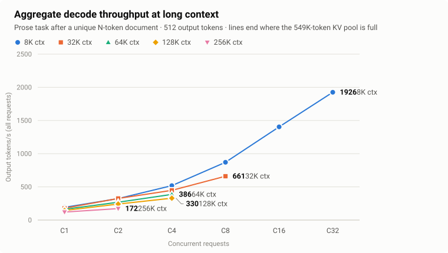

# Inkling-2-Mini on RTX PRO 6000 Blackwell (vLLM)

A tested recipe for serving [thinkingmachines/Inkling-2-Mini](https://huggingface.co/thinkingmachines/Inkling-2-Mini) with vLLM on NVIDIA RTX PRO 6000 Blackwell Workstation Edition GPUs (SM120, 96 GB), with the DSpark speculator that ships in the checkpoint.

**Status: Baseline, 1 GPU (TP1).** This is the official vLLM recipe plus the one fix SM120 needs to start. Optimized versions will be added as V1, V2, and so on; TP2 (2 GPUs) comes after TP1 is optimized.

## TL;DR

| | Baseline (TP1) |
|---|---|
| Single-user decode, prose / coding / counting | 176 / 312 / 396 tok/s |
| 8 users, combined | 852 / 1,326 / 2,165 tok/s |
| 32 users, combined | 2,097 / 3,530 / 5,094 tok/s |
| Prefill, 4K–16K prompt | ~19,000–19,800 tok/s |
| Prefill, 128K / 500K prompt | 11,826 / 5,218 tok/s (TTFT 11 s / 96 s) |
| Max context | 524,288 tokens |
| KV pool | 671,695 tokens (1.28 × 512K requests) |
| DSpark acceptance (K=7) | 30% of draft tokens, 3.1 tokens per step |
| Power (450 W cap) | 422–443 W average |

## Setup

- 1× RTX PRO 6000 Blackwell Workstation Edition (96 GB, 450 W), driver 595.99.02
- Image `vllm/vllm-openai:inkling-2-mini` (`sha256:c2dc759f…`): vLLM 0.1.dev25855, PyTorch 2.14 + CUDA 13.0, FlashInfer 0.7.4, Triton 3.8.0, Python 3.14
- Checkpoint `thinkingmachines/Inkling-2-Mini` @ `1fb4134b9a74f9681054f4ef82e4bf1f458a2337` (mixed NVFP4 / MXFP8, ~20 GB, plus the 0.6 GB DSpark drafter in `mtp.safetensors`)

## Quick start

```bash
hf download thinkingmachines/Inkling-2-Mini --revision 1fb4134b9a74f9681054f4ef82e4bf1f458a2337
./recipe/run.sh            # GPU=1 to use the second card; extra vllm flags are passed through
curl localhost:8000/v1/chat/completions -H 'Content-Type: application/json'   -d '{"model":"inkling-2-mini","messages":[{"role":"user","content":"Hello"}]}'
```

Startup takes about 4 minutes (most of it is CUDA graph capture for the model and the drafter). Reasoning is returned in `reasoning_content`; `reasoning_effort` (`none` … `max`) controls how much the model thinks.

### Flags and why

| Flag | Value | Why |
|---|---|---|
| `--speculative-config` | `dspark`, 7 tokens, probabilistic | From the official recipe |
| `--reasoning-parser` | `inkling` | From the official recipe |
| `--max-model-len` | 524288 | The full 1M context needs 52.6 GiB of KV cache; one 96 GB card gets at most ~48 GiB (vLLM estimates ~900K max) |
| `--gpu-memory-utilization` | 0.85 | At 0.90 and 0.95, warm-up runs out of memory in the sampler (a 5 GiB logits buffer) after the KV cache is allocated |
| `--revision` | pinned | The HF cache has no `refs/main` for an offline start without it |

## The patch

The `inkling-2-mini` image builds vLLM's compiled `_C` extension for SM100 (B200/GB200) only, with a few SM80 kernels. On SM120 the model's own kernels (Triton and FlashInfer) all work, but the KV-cache write `reshape_and_cache_flash` fails with `no kernel image is available for execution on the device`. The error surfaces later at an unrelated op inside the DSpark drafter (`dspark.py:209`), even with `CUDA_LAUNCH_BLOCKING=1`, because the failed launch isn't checked.

`patch/vllm/v1/attention/backends/fa_utils.py` (diff in `patch/diffs/`) swaps in vLLM's Triton `triton_reshape_and_cache_flash` on SM12x. It has the same signature and does the same copy: `tests/test_reshape_and_cache_triton.py` checks it is bit-identical to a reference scatter on the backend's strided cache layout. FlashAttention 2 kernels work on SM120 as shipped.

## Benchmarks

Method (`bench/`, stdlib Python against the OpenAI endpoint): prefill is one request at a time with unique random text so the prefix cache never hits, `max_tokens` 1, median of 5 warm sweeps. Decode is C concurrent requests, temperature 0, 1,024 output tokens (reasoning included); throughput is measured over the window in which all C requests are decoding. Long-context decode puts a unique N-token document before a short-story task, with 512 output tokens; cells that need more KV than the pool are skipped. Raw results are in `bench/results/baseline/`; tables come from `python3 bench/make_tables.py baseline`.

<picture><source media="(prefers-color-scheme: dark)" srcset="docs/charts/decode-aggregate-dark.svg"></picture>

<picture><source media="(prefers-color-scheme: dark)" srcset="docs/charts/decode-per-user-dark.svg"></picture>

<picture><source media="(prefers-color-scheme: dark)" srcset="docs/charts/decode-context-dark.svg"></picture>

### Prefill

| Prompt tokens | Baseline tok/s | Change | Time to first token (s) |
| --- | --- | --- | --- |
| 1,033 | **15,311** | — | 0.07 |
| 4,071 | **19,675** | — | 0.21 |
| 8,141 | **19,844** | — | 0.41 |
| 16,382 | **19,045** | — | 0.86 |
| 32,739 | **17,555** | — | 1.86 |
| 65,558 | **15,203** | — | 4.31 |
| 130,993 | **11,826** | — | 11.06 |
| 261,732 | **8,037** | — | 32.57 |
| 499,466 | **5,218** | — | 95.67 |

### Decode

| Workload | C | Baseline tok/s | Change | Per-user tok/s | TTFT p50 (s) |
| --- | --- | --- | --- | --- | --- |
| Prose (short story) | 1 | **175.7** | — | 175.7 | 0.04 |
|  | 2 | **298.9** | — | 149.7 | 0.16 |
|  | 4 | **498.1** | — | 124.1 | 0.79 |
|  | 8 | **851.9** | — | 106.0 | 0.06 |
|  | 16 | **1593.0** | — | 93.9 | 1.35 |
|  | 32 | **2097.4** | — | 65.3 | 2.50 |
| Coding (Python + tests) | 1 | **312.3** | — | 312.3 | 0.03 |
|  | 2 | **475.9** | — | 240.1 | 0.04 |
|  | 4 | **829.0** | — | 208.7 | 0.05 |
|  | 8 | **1325.7** | — | 162.8 | 0.06 |
|  | 16 | **2404.4** | — | 148.7 | 0.93 |
|  | 32 | **3530.1** | — | 115.6 | 1.34 |
| Counting (1…400 in words) | 1 | **395.8** | — | 395.8 | 0.04 |
|  | 2 | **704.6** | — | 364.8 | 0.05 |
|  | 4 | **1279.9** | — | 326.5 | 0.05 |
|  | 8 | **2164.6** | — | 280.6 | 0.06 |
|  | 16 | **3682.5** | — | 238.6 | 1.03 |
|  | 32 | **5093.6** | — | 164.7 | 2.51 |

DSpark during the decode matrix: 125,452 drafts, 262,111 of 878,164 draft tokens accepted (29.8%), so 3.09 tokens per verification step.

### Long-context decode

| Context | C | Baseline tok/s | Change | Per-user tok/s | TTFT p50 (s) |
| --- | --- | --- | --- | --- | --- |
| 8K | 1 | **178.2** | — | 178.2 | 0.4 |
| 8K | 2 | **307.8** | — | 153.5 | 0.8 |
| 8K | 4 | **482.1** | — | 121.5 | 2.6 |
| 8K | 8 | **866.8** | — | 77.5 | 2.8 |
| 8K | 16 | **1189.9** | — | 47.2 | 4.5 |
| 8K | 32 | **1607.3** | — | 29.9 | 7.9 |
| 16K | 1 | **183.7** | — | 183.7 | 0.9 |
| 16K | 2 | **289.7** | — | 145.6 | 1.7 |
| 16K | 4 | **449.9** | — | 104.6 | 3.1 |
| 16K | 8 | **712.5** | — | 55.5 | 4.9 |
| 16K | 16 | **1066.8** | — | 35.3 | 8.4 |
| 16K | 32 | **1436.0** | — | 12.9 | 15.6 |
| 32K | 1 | **162.6** | — | 162.6 | 1.9 |
| 32K | 2 | **264.0** | — | 115.8 | 3.1 |
| 32K | 4 | **424.9** | — | 79.4 | 5.7 |
| 32K | 8 | **616.2** | — | 37.3 | 9.5 |
| 32K | 16 | **941.8** | — | 18.6 | 17.1 |
| 64K | 1 | **163.4** | — | 163.4 | 4.3 |
| 64K | 2 | **262.2** | — | 99.0 | 6.8 |
| 64K | 4 | **350.7** | — | 46.6 | 11.4 |
| 64K | 8 | **500.8** | — | 24.1 | 20.8 |
| 128K | 1 | **146.1** | — | 146.1 | 11.1 |
| 128K | 2 | **211.1** | — | 70.3 | 17.0 |
| 128K | 4 | **278.4** | — | 24.4 | 30.4 |
| 256K | 1 | **114.8** | — | 114.8 | 33.3 |
| 256K | 2 | **147.8** | — | 47.1 | 49.7 |

### Power

| Phase | Avg / max power | Peak temp |
| --- | --- | --- |
| Prefill sweeps (5×, warm) | 443 / 471 W | 72 °C |
| Decode, C1–C32 | 422 / 464 W | 71 °C |
| Long-context decode | 427 / 459 W | 72 °C |

## Why the KV pool is 672K tokens

vLLM reports the pool as (number of full 512K-token requests that fit) × 512K = 1.28 × 524,288. The allocator holds 20,200 blocks of 64 tokens in 44.4 GiB. Of the 95 GiB card, 0.85 utilization caps vLLM at 80.7 GiB; weights and runtime take 23.2 GiB, and 9.5 GiB is kept for transient activations.

The model stores far less per token than this suggests. The middle 12 of its 24 layers run three times with separate KV caches per pass, so the full-attention caches are layers 5 and 23 once and layers 11 and 17 three times each: 8 caches, plus 1 in the drafter, at 8 KV heads × 128 × K/V × bf16, about 36 KiB per token. The sliding-window layers keep only 1,024 tokens. A 512K request, though, reserves about 15,800 blocks, about twice its 8,192 tokens' worth. vLLM's hybrid KV-cache planner groups caches into equal-sized groups and pads uneven ones (its log warns of up to 350% waste in one group), so the full-attention caches seem to end up in two padded groups. Fixing that grouping is the first V1 target.

## Next (V1 targets, lossless only)

- KV-cache grouping, so full-attention caches don't pay for padding layers (could roughly double the pool)
- Activation headroom: shrink the 9.5 GiB transient reserve (for example the sampler's warm-up batch) so utilization can go back to 0.90+
- Profile the decode step at C1 and C32
- DSpark draft length (K=7 at 30% acceptance)
- Then TP2 on both cards, with the full 1M context
